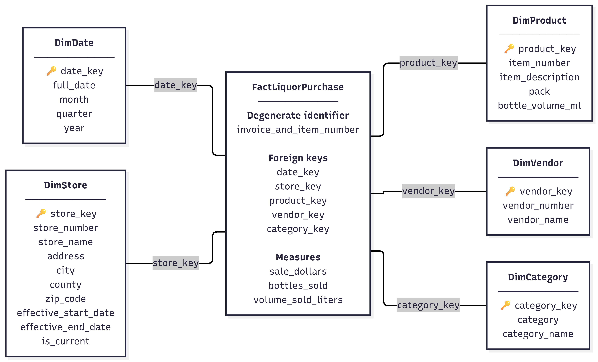

# P1 - Grain, Model, History & Pipeline Plan

## 1. Establish the question and check the source

### Audience and need

The intended audience is retail sales and category analysts who want to understand how liquor purchasing activity differs across product categories, vendors, stores, locations, and time in Iowa. The warehouse will make it easier for analysts to compare purchasing patterns without repeatedly working directly with the full source table.

### Primary analytical question

**How do retailer liquor purchase dollars vary across product categories and vendors over time in Iowa?**

This question focuses on identifying which product categories and vendors account for the largest retailer purchase dollars and whether those patterns change over time.

### Supporting question

**Which stores and counties account for the largest retailer purchasing activity within the highest-purchasing product categories and vendors?**

This supporting question adds a geographic and store-level view while still using the same warehouse model.

### Change from P0

The main change from P0 is that I narrowed the project from several possible sales questions to one primary analytical question. I also changed the wording from “sales dollars” to **retailer purchase dollars** because the source represents liquor purchased by Iowa retail stores rather than purchases made by individual consumers.

### Source

The source object is:

`bigquery-public-data.iowa_liquor_sales.sales`

One source row appears to represent one invoice-item line for a liquor product purchased by an Iowa retail store on a specific transaction date.

From my P0 profiling, the table contained **34,016,839 rows** and **24 columns**. The transaction dates I verified in BigQuery ranged from **January 3, 2012 through April 30, 2026**.

The main candidate identifier is `invoice_and_item_number`. In my P0 check, this field had **0 missing values** and **34,016,839 distinct values**, which matched the total row count. I did not find duplicate values in this field, so it appears to be a strong candidate for identifying one invoice-item fact row.

Important fields for the project include `date`, `store_number`, `store_name`, `city`, `county`, `category_name`, `vendor_number`, `vendor_name`, `item_number`, `item_description`, `bottles_sold`, and `sale_dollars`.

One important data issue is that descriptive labels such as store names, vendor names, and category names may change over time. I will need to check how these changes affect historical comparisons before using them as dimension attributes.

Another limitation is that the source represents retailer purchasing activity, not direct consumer alcohol consumption. Therefore, I will not interpret higher retailer purchase dollars as proof that people in an area consumed more alcohol.

### Grain check

I tested whether `invoice_and_item_number` can identify one fact row in the source.

The grain check returned:

| Result | Expected value | Observed value |
| --- | ---: | ---: |
| Source rows | 34,016,839 | 34,016,839 |
| Rows with missing `invoice_and_item_number` | 0 | 0 |
| Repeated `invoice_and_item_number` groups | 0 | 0 |

The result supports the proposed grain because every source row has an `invoice_and_item_number`, and I did not find any repeated identifier groups. Based on this check, I plan to use an invoice-item transaction line as the grain of the central fact table.

The reproducible SQL for this check is saved in:

`sql/01_source_profile.sql`

## 2. Define the model and predict a history consequence

### Business process, fact type, and grain

The business process is retailer liquor purchasing in Iowa.

The central fact table will be a **transaction fact table**.

**One row represents one invoice-item transaction line for one liquor product purchased by one Iowa retail store on one transaction date.**

The main measures in the fact table will include `sale_dollars`, `bottles_sold`, and `volume_sold_liters`. The main dimensions will be Date, Store, Product, Vendor, and Category.

### Modeling choice

One important modeling choice is to keep store, product, vendor, category, and date information in separate dimensions instead of repeating all descriptive attributes in the fact table. This will make it easier to compare purchasing activity by different business perspectives while keeping the fact table at a clear invoice-item grain.

The primary analytical question will be answered by using retailer purchase dollars from the fact table, grouping by product category and vendor, and filtering or grouping by the Date dimension to compare patterns over time.

### History decision

Store information can change over time. For example, a store name, address, or county value may change while the source store identifier remains the same.

I plan to use the source `store_number` as the business identifier and a separate warehouse store key in the Store dimension. The warehouse will use surrogate keys such as `date_key`, `store_key`, `product_key`, `vendor_key`, and `category_key` to connect the fact table to its dimensions, while source identifiers such as `store_number`, `item_number`, `vendor_number`, and `category` will remain business identifiers. `DimDate` will serve as the shared date dimension for consistent month, quarter, and year analysis.

For important historical store attributes, I plan to use a **Type 2 slowly changing dimension** so that a new dimension row can be created when a meaningful store attribute changes. This will allow older fact rows to remain connected to the store information that was valid when the transaction occurred.

This matters for the analytical question because a store or location change should not rewrite the meaning of older transactions. By preserving the historical store version, comparisons by store and location can remain consistent with the information that was valid at the time.

By P3, I plan to test a small store change case and confirm that transactions before and after the change connect to the correct historical store version. This Type 2 Store history decision mainly protects the supporting store and county analysis, while the primary category-vendor-time question depends more directly on consistent category, vendor, and date relationships.

### Model diagram

The dimensional model is shown below.

The model uses `FactLiquorPurchase` at the invoice-item transaction grain, connected to `DimDate`, `DimStore`, `DimProduct`, `DimVendor`, and `DimCategory`.

The grain of the fact table is:

**One row represents one invoice-item transaction line for one liquor product purchased by one Iowa retail store on one transaction date.**

### Question-to-model trace

The primary analytical question asks how retailer liquor purchase dollars vary across product categories and vendors over time in Iowa.

The model answers this question by using `sale_dollars` from `FactLiquorPurchase` as the main measure. `DimCategory` provides the product category used for grouping, `DimVendor` provides the vendor, and `DimDate` provides the month, quarter, or year used to compare purchasing patterns over time.

The supporting question about stores and counties can be answered through `DimStore`, which contains the store identifier, store name, city, county, and other location attributes.

This design keeps the fact table at one consistent invoice-item grain while allowing analysts to group the same transaction measures by the dimensions needed for the questions.

## 3. Plan the build and its checks

### Planned layers

| Layer | Planned object | Purpose |
| --- | --- | --- |
| Raw | `raw_iowa_liquor_sales` | Store the selected source fields from `bigquery-public-data.iowa_liquor_sales.sales` with minimal transformation. |
| Curated | `fact_liquor_purchase` and dimension tables | Apply the dimensional model, create warehouse keys, preserve the invoice-item grain, and prepare clean analytical fields. |
| Serving | `serving_purchase_by_category_vendor_time` | Summarize retailer purchase dollars by category, vendor, and time for the primary analytical question. |

### Preliminary run order

1. Read the selected fields from `bigquery-public-data.iowa_liquor_sales.sales`.
2. Load the Raw layer.
3. Build and validate the dimension tables.
4. Build `FactLiquorPurchase` at the invoice-item transaction grain.
5. Run grain and relationship checks.
6. Build the Serving output for category, vendor, and time analysis.
7. Reconcile Serving totals with the Curated fact table.

### Field trace

I will trace `sale_dollars` through the pipeline.

- **Source:** `sale_dollars` from `bigquery-public-data.iowa_liquor_sales.sales`
- **Raw:** retain the source value as `sale_dollars`
- **Curated:** keep `sale_dollars` as a transaction-level measure in `FactLiquorPurchase`
- **Serving:** sum `sale_dollars` by category, vendor, and time period to produce retailer purchase dollar totals for the primary analytical question

### Planned checks

| Risk | Planned check | Expected result | Where |
| --- | --- | --- | --- |
| The fact grain could be broken by duplicate invoice-item identifiers during the build. | Check that `invoice_and_item_number` remains unique in `FactLiquorPurchase`. | 0 repeated identifier groups | Curated |
| Missing or unmatched category/vendor keys could cause retailer purchase dollars to be excluded from the Serving result. | Count unmatched category and vendor relationships and reconcile total `sale_dollars` between Curated and Serving. | No unexplained loss of retailer purchase dollars | Curated and Serving |

### Access choice

The traced field, `sale_dollars`, is public and low-risk because it comes from the State of Iowa public dataset and does not identify individual consumers.

The intended users are retail sales and category analysts. The project owner and steward for this course project is the student author. `sale_dollars` can appear in the Serving output because it is necessary to answer the primary analytical question.

### Largest remaining limitation

The largest limitation is that the dataset measures liquor purchased by Iowa retail stores, not alcohol purchased or consumed by individual customers. Therefore, the project can describe retailer purchasing patterns but should not make direct claims about consumer alcohol consumption.

### First P2 build step

The first concrete P2 step will be to create the Raw table from the approved BigQuery source using only the fields needed for the planned dimensions, fact measures, and quality checks.

## 4. Diagnose and revise the plan

### P1 change memo

- **Feedback that changed my plan:** During peer diagnosis, I received feedback to narrow the project to fewer analytical questions so that the warehouse would have a clearer purpose. I reduced the project to one primary question about retailer purchase dollars by product category, vendor, and time, with one supporting question about stores and counties. I also received feedback about controlling query cost when working with the large Iowa Liquor Sales table.

- **What I changed and why:** I narrowed the analytical scope because focusing on one main question makes the dimensional model, measures, and Serving output easier to justify and test. I will also use small samples or limited date ranges only during early query development when I am checking syntax, joins, or general query logic. For final warehouse validation and analytical results, I plan to use the complete relevant dataset so that the results reflect the actual retailer purchasing patterns in the source.

- **Feedback I did not adopt and why:** I did not adopt the suggestion to base the final analysis on sampled data or move the project to PostgreSQL with another platform. Sampling could miss uncommon transactions, duplicate identifiers, unmatched dimension records, or less common stores, vendors, categories, and time periods. I want the final results to be based on the full relevant data so that the analysis is as realistic and reproducible as possible. I also kept BigQuery because the approved public source is already available there and the current warehouse plan and SQL are built around that environment.

- **Most important remaining uncertainty:** My main remaining uncertainty is how to control BigQuery processing cost while still running complete validation and final analysis on the full relevant dataset. In P2, I plan to separate low-cost development queries from the final validation and analytical queries that require complete data.

### AI and tool use

I used ChatGPT to help organize the P1 plan, clarify dimensional modeling concepts, and improve the wording of the documentation.

I verified the resulting claims and code by comparing them with the P1 assignment requirements, the course dimensional modeling materials, the actual BigQuery source schema, and the observed results from my profiling SQL. I also reviewed the final model and plan to make sure the analytical question, grain, dimensions, measures, and planned checks remained consistent with the source data.
